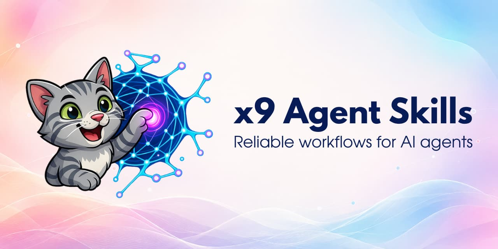

<p align="center">
  
</p>

<p align="center">
  Language: <strong>English</strong> · <a href="README.ru.md">Русский</a>
</p>

# x9 Agent Skills

[](https://skills.sh/xonika9/agent-skills)
[](https://github.com/xonika9/agent-skills/actions/workflows/validate.yml)
[](https://github.com/xonika9/agent-skills/releases/latest)

Practical [Agent Skills](https://agentskills.io/) for Claude Code, Codex, OpenCode, and other agents. They turn a loose request into careful work: research with real sources, product picks made through your own browser, measured speed-ups, tests that actually catch bugs, and prompts agents follow.

The `x9-` prefix keeps the skills easy to find and avoids collisions with similarly named packages. In Claude Code or Codex, type `/x9` to see the installed plugin skills.

> I share field notes on AI models and developer tools in [Контролируемые галлюцинации](https://t.me/+DOZWlhI4r4EyYjgy), a Russian-language Telegram channel.

## What it looks like

You talk to the agent in your own words; the matching skill takes over.

| You say | You get |
| --- | --- |
| "Research whether this claim is true" | An answer built on current sources, with the key claims checked, counter-evidence searched for, and a clear note on what could not be confirmed. |
| "Find me a good kettle on Wildberries under 3,000 ₽" | A short list made in your logged-in session after checking the exact variant, the seller, the price per unit, fresh low ratings, and buyer photos. |
| "The catalog page is slow, find out why" | A ranked list of measured causes. A fix stays only when repeated before-and-after measurements show it helped. |

## What makes these skills different

- **They check instead of guessing.** Facts, tests, and speed-ups are backed by evidence, and anything unverified is called out as such.
- **They ask before anything risky.** Deleting, spending money, publishing, or changing your settings waits for your approval.
- **They remember earlier work.** Audits leave notes in the project, so the next run shows what was fixed and what is new, and does not raise again what you deliberately declined.
- **They declare compatibility.** Package checks cover OpenCode, Claude Code, and Codex; runtime-specific skills state their restrictions in [Compatibility](#compatibility).

## Install

```bash
npx skills add xonika9/agent-skills
```

The interactive installer lets you choose the skills, agents, and installation scope. Afterwards, ask your agent to check them; [`x9-onboarding`](skills/x9-onboarding/SKILL.md) shows what is ready and what is still missing:

```text
Check whether my installed x9 skills are ready to use
```

<details>
<summary><strong>Claude Code and Codex plugins</strong></summary>

To install the complete package as a managed plugin:

```bash
claude plugin marketplace add xonika9/agent-skills
claude plugin install x9-agent-skills@xonika9
```

```bash
codex plugin marketplace add xonika9/agent-skills
codex plugin add x9-agent-skills@xonika9
```

In Claude Code, plugin skills use the plugin namespace, for example `/x9-agent-skills:x9-research`.

</details>

<details>
<summary><strong>Installing only some skills</strong></summary>

Some skills rely on others, and the installer does not add them automatically. If you install selectively, add the companions:

| If you install | Also install |
| --- | --- |
| `x9-research` | `x9-browser-session` for browser and social sources, `x9-okf-docs` for saving research |
| `x9-wb-product-search` | `x9-browser-session` |
| `x9-architecture-scout` | `x9-diagrams` |
| `x9-context-files-generator`, `x9-skill-creator`, `x9-okf-docs` | `x9-agent-instructions` |
| `x9-personal-vault` | `x9-okf-docs`, `x9-agent-instructions`; `x9-obsidian` for Obsidian work; `x9-context-files-generator` to tidy an existing `CLAUDE.md` |
| `x9-cto`, `x9-codex-delegation`, `x9-web-stack` | `x9-agent-instructions` (optional) for prompts or instruction blocks |
| `x9-idea-critic` in Claude Code | `x9-codex-delegation` for the GPT critic |
| `x9-appsec`, `x9-test-quality` | `x9-context-files-generator` (optional) when the project has no `AGENTS.md` |

Add `x9-onboarding` if you want the readiness check. To browse the catalog without installing, run `npx skills add xonika9/agent-skills --list`.

</details>

Clone or fork the repository only when you want to maintain your own variants; you will then merge upstream changes yourself.

## Skill catalog

### Everyday work

#### [Research from current sources · `x9-research`](skills/x9-research/SKILL.md)

- **When:** you need an answer built on current sources, not on the agent's memory.
- **You get:** a conclusion with links: the key claims are checked, counter-evidence was searched for, and anything that could not be confirmed is named plainly. On request the research is saved as Markdown, with an HTML report as well if you want one.

**Ask:**

```text
research this
```

```text
research X and give me an HTML report
```

#### [Work in your own browser · `x9-browser-session`](skills/x9-browser-session/SKILL.md)

- **When:** the result depends on your account, region, cart, or feed, so a clean test browser would give the wrong answer.
- **You get:** the agent keeps the browser or controller you explicitly selected; otherwise it follows the runtime's default route. Logged-in Edge work uses a separate automation profile and a task-owned tab. The agent leaves your tabs alone and does not solve CAPTCHAs.

**Needs:** for logged-in Edge work, one-time setup from the [setup guide](skills/x9-browser-session/references/setup.md), which you can hand to the agent; a tested recipe covers Edge on macOS.

**Ask:**

```text
open this in my browser
```

#### [Product picks on Wildberries · `x9-wb-product-search`](skills/x9-wb-product-search/SKILL.md)

- **When:** you are choosing a product on Wildberries and do not want to rely on the rating alone.
- **You get:** a short list made after checking the exact variant, the seller, the price per unit, fresh low ratings, recurring complaints, and buyer photos.

**Needs:** `x9-browser-session`; in Claude Code, a session running on Opus.

**Ask:**

```text
find a good kettle on Wildberries under 3,000 ₽
```

#### [Transcripts of your videos · `x9-video-transcripts`](skills/x9-video-transcripts/SKILL.md)

- **When:** you have recorded many videos and no longer remember which one covers what.
- **You get:** subtitles and timestamped text for one file or a whole folder, and later a search for the moment you said something. Everything runs on your machine; nothing is uploaded.

**Needs:** `python3`, `ffmpeg`, and `whisper-cli`; about 875 MB of models download on first use. Tested on macOS with Apple Silicon.

**Ask:**

```text
transcribe these videos
```

```text
where in my videos did I talk about pricing?
```

#### [A personal notes vault · `x9-personal-vault`](skills/x9-personal-vault/SKILL.md)

- **When:** your notes and documents are scattered across folders.
- **You get:** one vault with an inbox, an archive, and a folder per matter. The agent first shows a plan listing every move and changes nothing without your approval; after that, ordinary agent sessions keep the vault in order.

**Needs:** Python 3 for verified file moves and undo; companion skills are listed under selective installation.

**Ask:**

```text
organize my notes folder
```

```text
check my vault
```

#### [Working with Obsidian notes · `x9-obsidian`](skills/x9-obsidian/SKILL.md)

- **When:** you need to find, check, or edit notes in an Obsidian vault.
- **You get:** edits that keep links intact, repaired broken links, and work with properties, Bases, and Canvas. Checks are kept separate from fixes, and your folder structure stays yours.

**Ask:**

```text
find broken links in my vault
```

```text
rename this note and keep its links
```

#### [Pushback on an idea · `x9-idea-critic`](skills/x9-idea-critic/SKILL.md)

- **When:** you want objections before investing time in an idea, not another cheerful brainstorm.
- **You get:** a review by independent Claude and GPT critics: a recommendation, every problem that matters, a stronger version of the idea, and one next step. When the idea concerns your code, the critics also see facts from the repository.

**Needs:** access to Claude and GPT; with one provider it still works, but says there was no independent review.

**Ask:**

```text
criticize this idea
```

#### [Explain it another way · `x9-explain-again`](skills/x9-explain-again/SKILL.md)

- **When:** you did not understand the agent's last answer in this chat.
- **You get:** the same point explained differently: in plainer words, with an example, or through an analogy.

**Ask:**

```text
I didn't get that, explain it differently
```

#### [Diagrams · `x9-diagrams`](skills/x9-diagrams/SKILL.md)

- **When:** you need a diagram of a process, an architecture, or relationships, or want to convert a diagram to another format.
- **You get:** an editable source in Excalidraw, Mermaid, draw.io, or SVG, checked by actually rendering it. If a table would explain it better, the skill says so.

**Needs:** a renderer or editor for the chosen format; Python 3.9 or newer for the bundled checks.

**Ask:**

```text
draw a diagram of this flow
```

```text
convert this Mermaid diagram to draw.io
```

#### [Images through Codex · `x9-codex-imagegen`](skills/x9-codex-imagegen/SKILL.md)

- **When:** you work in Claude Code, OpenCode, or another agent and need a picture.
- **You get:** an image made through your Codex subscription, with no separate image API key. Codex writes the image prompt itself, and you get a verified PNG together with that prompt.

**Needs:** Codex with a ChatGPT login. Inside Codex itself the skill is not needed.

**Ask:**

```text
generate an illustration for this article with Codex
```

### Building software

#### [A well-structured web project · `x9-web-stack`](skills/x9-web-stack/SKILL.md)

- **When:** you are starting a TypeScript web app or want to check how an existing project on any stack is organized.
- **You get:** a project on Bun, React, Hono, and PostgreSQL, split into modules whose boundaries the linter enforces, or an audit of an existing project's structure and rules with the most important findings first. The rules can be written into `AGENTS.md`.

**Needs:** Python 3, Bun, Node, Git, and Docker for a new project.

**Ask:**

```text
create a project on our stack
```

```text
audit this project's structure and stack
```

#### [Web app security · `x9-appsec`](skills/x9-appsec/SKILL.md)

- **When:** you are building a public site or API, or preparing one for release.
- **You get:** a check of trust boundaries across the whole application (browser, API, data stores, and deployment), with evidence, possible harm, priority, and the smallest fix for each problem. The agent attacks a running service only with your explicit permission.

**Ask:**

```text
check this change for security issues
```

```text
run a security audit before release
```

#### [Tests that catch bugs · `x9-test-quality`](skills/x9-test-quality/SKILL.md)

- **When:** the agent writes tests that prove nothing, the suite collects duplicates and flaky tests, or you are unsure how testing should be organized.
- **You get:** useless tests are kept out of the project, redundant and flaky ones are found with evidence, and testing advice fits the size of your project. Tests, configuration, and CI change only with your approval.

**Ask:**

```text
review our tests
```

```text
how should we set up testing here?
```

#### [Finding slowdowns and waste · `x9-performance`](skills/x9-performance/SKILL.md)

- **When:** something is slow, cannot hold its load, or spends too much memory or money.
- **You get:** measurements of where resources actually go and a list of causes with the most important first. A fix stays only when repeated before-and-after measurements show it helped.

**Ask:**

```text
why is this page slow?
```

```text
run a performance audit
```

#### [Architecture review · `x9-architecture-scout`](skills/x9-architecture-scout/SKILL.md)

- **When:** you need to understand a repository's architecture or choose between several directions.
- **You get:** an HTML report with no code changes: component boundaries, dependencies, risky change hotspots, and a comparison of directions with evidence.

**Needs:** `python3` and `x9-diagrams`.

**Ask:**

```text
audit this codebase's architecture
```

#### [CTO-level decisions · `x9-cto`](skills/x9-cto/SKILL.md)

- **When:** you need a call on product scope, architecture, or a large technical commitment.
- **You get:** a CTO's view grounded in your repository. It can also lead delivery to a working user outcome and check executors' reports against real evidence.

**Needs:** nothing extra for a consultation; the autonomous `auto` mode needs the Compound Engineering skills `ce-plan`, `ce-work`, `ce-simplify-code`, and `ce-code-review`. Independent review modes need subagents.

**Ask:**

```text
should we move to X?
```

#### [A decision map before planning · `x9-decision-map`](skills/x9-decision-map/SKILL.md)

- **When:** a large initiative stalls because open choices, missing facts, and nice-to-have work are mixed together.
- **You get:** one decision map: what is decided, which questions remain, what depends on what, and what to find out next. A later session picks it up without starting over.

**Ask:**

```text
map the decisions before we plan
```

#### [Breaking a plan into work items · `x9-task-graph`](skills/x9-task-graph/SKILL.md)

- **When:** you have an approved plan and need to move it into a tracker.
- **You get:** connected work items with dependencies, a list of what can start right away, and a check that every requirement of the plan landed in some item. It does not reopen decisions.

**Ask:**

```text
turn this approved plan into work items
```

### Working with agents

#### [Post-install check · `x9-onboarding`](skills/x9-onboarding/SKILL.md)

- **When:** you have just installed or updated the skills.
- **You get:** a list of what is ready and what is still missing: a command-line tool, an account, or another component. Optionally, a comparison of your Claude Code, Codex, or OpenCode settings with the author's profile and a merge of the differences you choose, with a backup.

**Needs:** Python 3.11 or newer.

**Ask:**

```text
check whether my x9 skills are ready
```

#### [Prompts and agent instructions · `x9-agent-instructions`](skills/x9-agent-instructions/SKILL.md)

- **When:** you need a prompt for a task or a second look at instructions you already wrote.
- **You get:** a ready prompt from your own description, even a dictated one: goal, constraints, sources, authority, deliverable, and what counts as done. For existing instructions, suggested edits with what each one gives you.

**Ask:**

```text
write me a prompt for this task
```

```text
review these instructions
```

<details>
<summary>Sources the method is based on</summary>

- [Prompting best practices](https://platform.claude.com/docs/en/build-with-claude/prompt-engineering/claude-prompting-best-practices)
- [Prompting Claude Fable 5.1](https://platform.claude.com/docs/en/build-with-claude/prompt-engineering/prompting-claude-fable-5-1)
- [Prompting Claude Fable 5](https://platform.claude.com/docs/en/build-with-claude/prompt-engineering/prompting-claude-fable-5)
- [Prompting Claude Opus 5.5](https://platform.claude.com/docs/en/build-with-claude/prompt-engineering/prompting-claude-opus-5-5)
- [Prompting Claude Opus 5](https://platform.claude.com/docs/en/build-with-claude/prompt-engineering/prompting-claude-opus-5)
- [The new rules of context engineering for Claude 5 generation models](https://claude.com/blog/the-new-rules-of-context-engineering-for-claude-5-generation-models)
- [Using GPT-6 Astra](https://developers.openai.com/api/docs/guides/latest-model?model=gpt-6-astra)
- [Using GPT-5.6](https://developers.openai.com/api/docs/guides/latest-model?model=gpt-5.6)

</details>

#### [README and AGENTS.md for a repository · `x9-context-files-generator`](skills/x9-context-files-generator/SKILL.md)

- **When:** a repository lacks `README.md`, `AGENTS.md`, or `CLAUDE.md`, or they are out of date.
- **You get:** files based on the project's real commands, structure, and CI, not a generated file tree with generic advice. Ready-made rule blocks can be added on request.

**Ask:**

```text
create AGENTS.md for this repository
```

```text
update the README
```

#### [Building and auditing skills · `x9-skill-creator`](skills/x9-skill-creator/SKILL.md)

- **When:** you want to turn a repeated process into a skill or check one you already have.
- **You get:** a skill with clear trigger conditions, structure, safety boundaries, and checks for Claude Code, Codex, and the portable format. Every audit also suggests what can be removed.

**Needs:** Python 3 and Ruby with Psych for structural validation; `x9-agent-instructions` for instruction review.

**Ask:**

```text
turn this process into a skill
```

```text
audit this skill
```

#### [Agent loops for repeated work · `x9-loop-engineering`](skills/x9-loop-engineering/SKILL.md)

- **When:** you keep walking the agent through the same cycle by hand: explore, plan, do, check, fix.
- **You get:** the design of a bounded agent loop with saved state, checkpoints, and stop conditions. `x9-skill-creator` can then package it as a skill.

**Ask:**

```text
design an agent loop for this workflow
```

#### [Headers for Markdown documents · `x9-okf-docs`](skills/x9-okf-docs/SKILL.md)

- **When:** there are so many Markdown documents that the agent struggles to find the right one.
- **You get:** a short [OKF](https://github.com/GoogleCloudPlatform/open-knowledge-format) header on each document: type, title, a one-line description, and tags. Headers are added as documents are written, and a whole folder can be converted in one step without changing any text.

**Needs:** Python 3.9 or newer and Ruby with Psych for scripts; `x9-agent-instructions` for local instruction rules.

**Ask:**

```text
add OKF metadata
```

```text
migrate this folder to OKF
```

#### [Handing work from Claude Code to Codex · `x9-codex-delegation`](skills/x9-codex-delegation/SKILL.md)

- **When:** you work in Claude Code and want Codex to take a well-defined part of the task, for example to spread work across subscription limits.
- **You get:** the result from Codex, checked by Claude against the actual diff rather than the report.

**Needs:** Claude Code with Codex installed.

**Ask:**

```text
hand this part to Codex
```

#### [Managing OpenCode chats · `x9-opencode-sessions`](skills/x9-opencode-sessions/SKILL.md)

- **When:** work in OpenCode has spread across several chats.
- **You get:** finding, reading, and continuing other chats, waiting for them to finish, and collecting the results. A message is sent only after you see a preview.

**Needs:** OpenCode V2.

**Ask:**

```text
find the OpenCode session about the migration
```

```text
wait for that session to finish
```
## Compatibility

The skills use the open Agent Skills format and are checked in OpenCode, Claude Code, and Codex. Three are tied to specific agents by design: `x9-codex-delegation` runs only in Claude Code, `x9-codex-imagegen` is for agents other than Codex, and `x9-opencode-sessions` runs only in OpenCode V2.

## Global instruction files

The repository also includes example global instructions for [OpenCode](global-files/opencode/AGENTS.md), [Codex](global-files/codex/AGENTS.md), and [Claude Code](global-files/claude/CLAUDE.md): language, what the agent may do on its own, preserving your changes, verifiable completion, browser routing, and subagent use. Do not overwrite your own file with them. Back it up and ask the agent:

```text
Use x9-agent-instructions to review these examples and merge only the rules that fit my setup
```

## Updates

```bash
npx skills update -g              # all globally installed skills
npx skills update x9-research -g  # one skill
```

Plugins update through your agent's marketplace. What changed in each release, and what to do when upgrading, is in [CHANGELOG.md](CHANGELOG.md).

## Contributing and security

Bug reports, focused skill improvements, and reproducible compatibility findings are welcome; read [CONTRIBUTING.md](CONTRIBUTING.md) before opening a pull request. Report vulnerabilities through [SECURITY.md](SECURITY.md), not a public issue. Community conduct is covered by the [Code of Conduct](CODE_OF_CONDUCT.md).

If this package saves you time, [star the repository](https://github.com/xonika9/agent-skills) so more people can find it. For new experiments and practical notes, follow [Контролируемые галлюцинации](https://t.me/+DOZWlhI4r4EyYjgy).

## License

[MIT](LICENSE). Use individual skills, adapt them, or assemble your own package.
