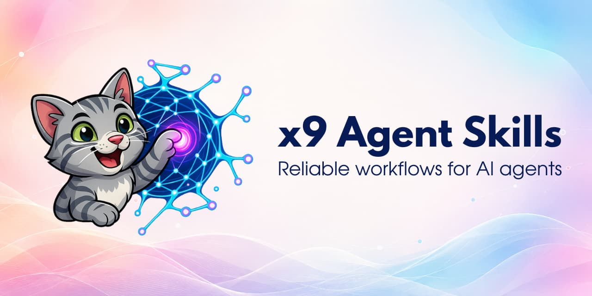

<p align="center">
  
</p>

<p align="center">
  Язык: <a href="README.md">English</a> · <strong>Русский</strong>
</p>

# x9 Agent Skills

[](https://skills.sh/xonika9/agent-skills)
[](https://github.com/xonika9/agent-skills/actions/workflows/validate.yml)
[](https://github.com/xonika9/agent-skills/releases/latest)

Практические [Agent Skills](https://agentskills.io/) для Claude Code, Codex, OpenCode и других агентов. С ними расплывчатая просьба превращается в аккуратную работу: исследование по настоящим источникам, подбор товара в твоём собственном браузере, ускорение, подтверждённое замерами, тесты, которые ловят ошибки, и промпты, которым агенты следуют.

Префикс `x9-` помогает быстро найти скиллы и не путать их с одноимёнными пакетами. В Claude Code и Codex достаточно ввести `/x9`, чтобы увидеть установленные скиллы плагина.

> Полевыми заметками об AI-моделях и инструментах для разработчиков я делюсь в телеграм-канале [«Контролируемые галлюцинации»](https://t.me/+DOZWlhI4r4EyYjgy).

## Как это выглядит

Ты говоришь с агентом своими словами, а подходящий скилл подключается сам.

| Ты говоришь | Ты получаешь |
| --- | --- |
| «Разберись, правда ли это» | Ответ по актуальным источникам: главные утверждения проверены, опровержения поискали, а то, что подтвердить не удалось, названо прямо. |
| «Подбери хороший чайник на Wildberries до 3000 ₽» | Короткий список, собранный в твоей авторизованной сессии после проверки нужного варианта товара, продавца, цены за единицу, свежих низких оценок и фотографий покупателей. |
| «Страница каталога тормозит, найди почему» | Причины тормозов, подтверждённые замерами, и самые тяжёлые идут первыми. Правка остаётся, только если повторные замеры до и после показали выигрыш. |

## Чем эти скиллы отличаются

- **Проверяют, а не угадывают.** За фактами, тестами и ускорением стоят доказательства, а всё непроверенное помечено.
- **Спрашивают перед рискованным.** Удаление, траты, публикация и изменение твоих настроек ждут твоего согласия.
- **Помнят прошлую работу.** Аудиты оставляют в проекте заметки, поэтому следующий запуск покажет, что исправлено и что появилось, и не станет снова предлагать то, от чего ты сознательно отказался.
- **Работают в любом совместимом агенте.** Каждый скилл проверен в OpenCode, Claude Code и Codex.

## Установка

```bash
npx skills add xonika9/agent-skills
```

В интерактивном установщике можно выбрать скиллы, агентов и область установки. После установки попроси агента проверить их, и [`x9-onboarding`](skills/x9-onboarding/SKILL.md) покажет, что уже работает, а чего не хватает:

```text
Проверь, готовы ли мои установленные x9-скиллы к работе
```

<details>
<summary><strong>Плагины для Claude Code и Codex</strong></summary>

Чтобы поставить весь набор как управляемый плагин:

```bash
claude plugin marketplace add xonika9/agent-skills
claude plugin install x9-agent-skills@xonika9
```

```bash
codex plugin marketplace add xonika9/agent-skills
codex plugin add x9-agent-skills@xonika9
```

В Claude Code скиллы плагина вызываются через его пространство имён, например `/x9-agent-skills:x9-research`.

</details>

<details>
<summary><strong>Если ставишь не все скиллы</strong></summary>

Некоторые скиллы опираются на другие, а установщик не добавляет их сам. При выборочной установке поставь и связанные:

| Если ставишь | Добавь |
| --- | --- |
| `x9-research` | `x9-browser-session` для браузера и соцсетей, `x9-okf-docs` для сохранения исследований |
| `x9-wb-product-search` | `x9-browser-session` |
| `x9-architecture-scout` | `x9-diagrams` |
| `x9-context-files-generator`, `x9-skill-creator`, `x9-okf-docs` | `x9-agent-instructions` |
| `x9-personal-vault` | `x9-okf-docs`, `x9-agent-instructions`; `x9-context-files-generator`, чтобы привести в порядок существующий `CLAUDE.md` |
| `x9-idea-critic` в Claude Code | `x9-codex-delegation` для критика GPT |
| `x9-appsec`, `x9-test-quality` | `x9-context-files-generator` (по желанию), если в проекте нет `AGENTS.md` |

Добавь `x9-onboarding`, если нужна проверка готовности. Посмотреть каталог без установки: `npx skills add xonika9/agent-skills --list`.

</details>

Клонировать или форкать репозиторий стоит, только если хочешь вести собственные варианты. Обновления из исходного репозитория тогда придётся переносить самому.

## Каталог скиллов

### Каждый день

#### [`x9-research`](skills/x9-research/SKILL.md)

Агенты часто выдают правдоподобный ответ по памяти за исследование. Этот скилл заставляет их открывать актуальные источники, проверять утверждения, на которых держится вывод, искать опровержения и прямо говорить, что подтвердить не удалось. X/Twitter он читает через твой авторизованный браузер, а Reddit и форумы считает живым опытом, но не доказательством. По просьбе результат сохраняется в Markdown-заметку или в HTML-отчёт для чтения, и его можно обновить позже.

**Скажи агенту:**

```text
разберись в вопросе
```

```text
ресерч по теме X + html
```

#### [`x9-browser-session`](skills/x9-browser-session/SKILL.md)

Результат личной задачи зависит от твоего аккаунта, региона, корзины или ленты, поэтому чистый тестовый браузер даст неверный ответ. Скилл позволяет агенту работать в твоём авторизованном браузере через отдельный профиль автоматизации, в собственной вкладке и не трогая твои. Перед капчей он останавливается и не пытается её обойти.

**Скажи агенту:**

```text
открой в моём браузере
```

```text
используй мою сессию
```

**Нужно:** один раз настроить по [инструкции](skills/x9-browser-session/references/setup.md), её можно просто передать агенту. Проверенный рецепт есть для Edge на macOS.

#### [`x9-wb-product-search`](skills/x9-wb-product-search/SKILL.md)

Рейтинг на Wildberries редко показывает всю картину: отзывы могут относиться к другому варианту, продавец бывает сомнительным, а цена зависит от аккаунта и региона. Скилл проверяет нужный вариант, продавца, цену за единицу, свежие низкие оценки, повторяющиеся жалобы и фотографии покупателей и только потом даёт короткий список.

**Скажи агенту:**

```text
подбери хороший чайник на WB до 3000 ₽
```

**Нужно:** `x9-browser-session`; в Claude Code сессия должна работать на Opus.

#### [`x9-video-transcripts`](skills/x9-video-transcripts/SKILL.md)

Записал десяток роликов и уже не помнишь, в каком о чём рассказывал? Скилл расшифровывает твои видео и аудио прямо на компьютере, один файл или целую папку, в субтитры и текст с тайм-кодами, а потом находит момент, где прозвучала нужная фраза. Ничего никуда не загружается, а повторный запуск обрабатывает только новые и изменённые файлы.

**Скажи агенту:**

```text
расшифруй ролики
```

```text
где в роликах я говорил про цены?
```

**Нужно:** `python3`, `ffmpeg` и `whisper-cli`; около 875 МБ моделей скачаются при первом запуске. Проверено на macOS с Apple Silicon.

#### [`x9-personal-vault`](skills/x9-personal-vault/SKILL.md)

Собирает заметки и документы, разбросанные по папкам, в одно личное хранилище: «Входящее», архив и по папке на каждое дело, будь то здоровье или один налоговый вопрос. Агент показывает один план со всеми переносами и ничего не меняет до твоего согласия. Копии сверяются, а откатить можно всё, кроме отдельно подтверждённого удаления. Дальше порядок поддерживают обычные сессии агента, без вызова скилла.

**Скажи агенту:**

```text
организуй мою папку
```

```text
собери мои папки в одно хранилище
```

#### [`x9-obsidian`](skills/x9-obsidian/SKILL.md)

Находит, проверяет и правит заметки в хранилище Obsidian: сохраняет ссылки при переносе файлов, чинит битые и работает со свойствами, Bases и Canvas. Проверка отделена от исправлений, а скилл следует твоей структуре папок.

**Скажи агенту:**

```text
проверь битые ссылки
```

```text
переименуй заметку и сохрани ссылки
```

#### [`x9-idea-critic`](skills/x9-idea-critic/SKILL.md)

Нужен, когда хочется услышать возражения, а не очередной бодрый брейншторм. Идею разбирают независимые критики Claude и GPT, а ты получаешь рекомендацию, все существенные проблемы, улучшенную версию идеи и один следующий шаг с понятным условием, продолжать или остановиться. Если идея касается твоего кода, отдельный разведчик сначала читает репозиторий, и критики узнают факты, о которых никто не упомянул.

**Скажи агенту:**

```text
раскритикуй идею
```

```text
найди слабые места
```

**Нужно:** работает и с одним провайдером, но тогда прямо сообщает, что независимой проверки не было.

#### [`x9-explain-again`](skills/x9-explain-again/SKILL.md)

Скажи, что не понял предыдущий ответ, и скилл объяснит то же место иначе: проще, на примере, через аналогию или цепочку причин. Тему он заново не начинает и ответ не раздувает.

**Скажи агенту:**

```text
не понял, объясни иначе
```

#### [`x9-diagrams`](skills/x9-diagrams/SKILL.md)

Подбирает подходящий вид схемы или подсказывает, что таблица справится лучше, и создаёт редактируемый исходник в Excalidraw, Mermaid, draw.io или SVG. Слишком плотную схему он делит на обзор и подробные части, а не уменьшает шрифт, и проверяет результат настоящей отрисовкой.

**Скажи агенту:**

```text
нарисуй схему этого процесса
```

```text
переведи эту схему Mermaid в draw.io
```

#### [`x9-codex-imagegen`](skills/x9-codex-imagegen/SKILL.md)

Позволяет Claude Code, OpenCode или другому агенту рисовать картинки по твоей подписке Codex, без отдельного ключа к API изображений. Промпт для картинки Codex пишет сам, поэтому качество не зависит от модели, на которой ты работаешь. На выходе проверенный PNG и итоговый промпт.

**Скажи агенту:**

```text
сгенерируй картинку через Codex
```

**Нужно:** Codex с входом через ChatGPT. Внутри самого Codex скилл не нужен.

### Разработка

#### [`x9-web-stack`](skills/x9-web-stack/SKILL.md)

Шаблон веб-приложения на TypeScript: инструменты, устройство кода и правила, которые не дают проекту расползтись. Код делится на модули по областям продукта со своей точкой входа, своими таблицами и зависимостями в одну сторону, и эти границы проверяет линтер. Новый проект начинается с заготовки, которую целиком собрали и запустили (Bun, React, Hono, PostgreSQL), а готовый проект на любом стеке получает аудит структуры и правил. Правила можно записать в `AGENTS.md`, чтобы агенты соблюдали их в повседневной работе.

**Скажи агенту:**

```text
создай проект на нашем стеке
```

```text
проверь структуру и стек проекта
```

**Нужно:** для нового проекта Python 3, Bun, Node, Git и Docker.

#### [`x9-appsec`](skills/x9-appsec/SKILL.md)

Прослеживает границы доверия по всему приложению: браузер, API, фоновые задания, хранилища, интеграции и развёртывание. Во время разработки проверяет изменённый путь, а перед выпуском проводит аудит и для каждой проблемы даёт доказательство, возможный ущерб, приоритет и наименьшее исправление. Атакующие запросы к работающему сервису он отправляет только с твоего явного разрешения и на названную цель.

**Скажи агенту:**

```text
проверь это изменение на безопасность
```

```text
проведи аудит безопасности перед релизом
```

#### [`x9-test-quality`](skills/x9-test-quality/SKILL.md)

Агенты охотно добавляют тесты, которые увеличивают их число, но ничего не ловят. Скилл не пускает такие тесты в проект, находит в готовом наборе лишние и нестабильные и советует, как устроить тестирование под размер твоего проекта. Тесты, конфигурация и CI меняются только после твоего согласия.

**Скажи агенту:**

```text
проверь тесты
```

```text
у нас флакают тесты
```

#### [`x9-performance`](skills/x9-performance/SKILL.md)

Вместо кэша «на всякий случай» агент замеряет, куда на самом деле уходят время, память или деньги, и оставляет правку, только если повторные замеры до и после доказали пользу. Аудит возвращает список, где самое важное сверху: что можно починить сразу, какие решения за тобой (с выгодой и ценой) и где не хватает данных.

**Скажи агенту:**

```text
почему так долго?
```

```text
проведи аудит оптимизации
```

#### [`x9-architecture-scout`](skills/x9-architecture-scout/SKILL.md)

Обзор архитектуры в виде HTML-отчёта без правок в коде: границы компонентов, зависимости, кто чем владеет, места, где изменения особенно рискованны, и сравнение возможных направлений с доказательствами и степенью уверенности.

**Скажи агенту:**

```text
проведи архитектурный аудит
```

**Нужно:** `python3` и `x9-diagrams`.

#### [`x9-cto`](skills/x9-cto/SKILL.md)

Взгляд CTO на продуктовые границы, архитектуру или крупное техническое решение с опорой на твой репозиторий. Может и вести работу до результата, который реально получает пользователь, и проверять отчёты исполнителей по доказательствам, а не верить им на слово.

**Скажи агенту:**

```text
стоит ли переходить на X?
```

```text
посмотри как CTO
```

**Нужно:** для консультации ничего дополнительного; автономному режиму `auto` нужны скиллы Compound Engineering `ce-plan`, `ce-work`, `ce-simplify-code` и `ce-code-review`.

#### [`x9-decision-map`](skills/x9-decision-map/SKILL.md)

Большая инициатива вязнет, когда открытые выборы, недостающие факты и работа «на всякий случай» смешаны в одном списке. До планирования скилл собирает одну карту решений: что решено, какие вопросы остались, что от чего зависит и что выяснить дальше. Новая сессия продолжит с неё, не начиная заново.

**Скажи агенту:**

```text
составь карту решений
```

#### [`x9-task-graph`](skills/x9-task-graph/SKILL.md)

Превращает утверждённый план в связанные задачи для трекера: с зависимостями, списком того, что можно начать сразу, и проверкой, что каждое требование плана попало в какую-то задачу. Решения не пересматривает и лишней работы не придумывает.

**Скажи агенту:**

```text
разбей утверждённый план на задачи
```

### Работа с агентами

#### [`x9-onboarding`](skills/x9-onboarding/SKILL.md)

После установки или обновления проверяет, какие скиллы готовы к работе и чего не хватает: программы, аккаунта или другого компонента. Ещё может сравнить твои настройки Claude Code, Codex или OpenCode с профилем автора и перенести выбранные тобой отличия, сохранив резервную копию.

**Скажи агенту:**

```text
проверь готовность x9-скиллов
```

#### [`x9-agent-instructions`](skills/x9-agent-instructions/SKILL.md)

Опиши задачу своими словами, хоть голосом, и получи готовый промпт: цель, ограничения, источники, полномочия, результат и критерий готовности. Скилл также проверяет уже написанные промпты и файлы инструкций, включая глобальные `AGENTS.md` и `CLAUDE.md`, и объясняет, что даст каждая предложенная правка.

**Скажи агенту:**

```text
напиши промпт под эту задачу
```

```text
проверь инструкции
```

<details>
<summary>На чём основан метод</summary>

- [Prompting best practices](https://platform.claude.com/docs/en/build-with-claude/prompt-engineering/claude-prompting-best-practices)
- [Prompting Claude Fable 5.1](https://platform.claude.com/docs/en/build-with-claude/prompt-engineering/prompting-claude-fable-5-1)
- [Prompting Claude Fable 5](https://platform.claude.com/docs/en/build-with-claude/prompt-engineering/prompting-claude-fable-5)
- [Prompting Claude Opus 5.5](https://platform.claude.com/docs/en/build-with-claude/prompt-engineering/prompting-claude-opus-5-5)
- [Prompting Claude Opus 5](https://platform.claude.com/docs/en/build-with-claude/prompt-engineering/prompting-claude-opus-5)
- [The new rules of context engineering for Claude 5 generation models](https://claude.com/blog/the-new-rules-of-context-engineering-for-claude-5-generation-models)
- [Using GPT-6 Astra](https://developers.openai.com/api/docs/guides/latest-model?model=gpt-6-astra)
- [Using GPT-5.6](https://developers.openai.com/api/docs/guides/latest-model?model=gpt-5.6)

</details>

#### [`x9-context-files-generator`](skills/x9-context-files-generator/SKILL.md)

Создаёт или обновляет `README.md`, `AGENTS.md` и `CLAUDE.md` репозитория по его настоящим командам, структуре и CI, а не генерирует дерево файлов с общими советами. По желанию добавляет готовые блоки правил: дисциплина работы, документация, обновление зависимостей и другие.

**Скажи агенту:**

```text
создай AGENTS.md
```

```text
обнови README
```

#### [`x9-skill-creator`](skills/x9-skill-creator/SKILL.md)

Упаковывает повторяющийся процесс в Agent Skill или проверяет готовый: когда он срабатывает, как устроен, где его границы безопасности и как его проверить для Claude Code, Codex и переносимого формата. В каждом аудите есть и предложения, что можно убрать.

**Скажи агенту:**

```text
сделай из этого процесса скилл
```

```text
проверь этот скилл
```

#### [`x9-loop-engineering`](skills/x9-loop-engineering/SKILL.md)

Если ты раз за разом вручную ведёшь агента по одному и тому же кругу (разобраться, спланировать, сделать, проверить, исправить), скилл спроектирует ограниченный агентный цикл с сохраняемым состоянием, точками проверки и условиями остановки. Потом `x9-skill-creator` упакует его в скилл.

**Скажи агенту:**

```text
спроектируй агентный цикл для этого процесса
```

#### [`x9-okf-docs`](skills/x9-okf-docs/SKILL.md)

Добавляет каждому Markdown-документу короткую шапку [OKF](https://github.com/GoogleCloudPlatform/open-knowledge-format): тип, заголовок, описание в одну строку и теги. По ней агент выбирает нужный файл, не открывая его. Шапка появляется прямо при написании документа, а целую папку можно перевести за один шаг, не меняя текста документов.

**Скажи агенту:**

```text
добавь OKF-метаданные
```

```text
адаптируй папку под OKF
```

#### [`x9-codex-delegation`](skills/x9-codex-delegation/SKILL.md)

Позволяет из Claude Code передать в Codex чётко очерченную часть работы, а потом проверить настоящий дифф, а не верить отчёту. Полезно, когда Codex лучше подходит для задачи или когда нужно распределить работу между лимитами подписок.

**Скажи агенту:**

```text
отдай эту часть в Codex
```

**Нужно:** Claude Code и установленный Codex.

#### [`x9-opencode-sessions`](skills/x9-opencode-sessions/SKILL.md)

Находит, читает, продолжает и координирует другие чаты OpenCode, дожидается их завершения и собирает результаты. Сообщение уходит только после того, как ты увидел его заранее.

**Скажи агенту:**

```text
найди сессию OpenCode про миграцию
```

```text
дождись завершения сессии
```

**Нужно:** OpenCode V2.

## Совместимость

Скиллы используют открытый формат Agent Skills и проверены в OpenCode, Claude Code и Codex. Три из них по своему назначению привязаны к определённым агентам: `x9-codex-delegation` работает только в Claude Code, `x9-codex-imagegen` нужен агентам, кроме Codex, а `x9-opencode-sessions` работает только в OpenCode V2.

## Глобальные файлы инструкций

В репозитории есть примеры глобальных инструкций для [OpenCode](global-files/opencode/AGENTS.md), [Codex](global-files/codex/AGENTS.md) и [Claude Code](global-files/claude/CLAUDE.md): язык общения, что агент может делать сам, сохранение твоих изменений, проверяемый критерий готовности, работа с браузером и субагентами. Не затирай ими свой файл. Сохрани копию и попроси агента:

```text
Используй x9-agent-instructions: изучи эти примеры и добавь только подходящие мне правила
```

## Обновление

```bash
npx skills update -g              # все глобально установленные скиллы
npx skills update x9-research -g  # один скилл
```

Плагины обновляются через marketplace твоего агента. Что изменилось в каждом выпуске и что сделать при переходе, описано в [CHANGELOG.md](CHANGELOG.md).

## Участие в проекте и безопасность

Можно присылать баг-репорты, точечные улучшения скиллов и воспроизводимые наблюдения о совместимости. Перед pull request прочитай [CONTRIBUTING.md](CONTRIBUTING.md). Об уязвимостях сообщай по инструкции в [SECURITY.md](SECURITY.md), а не через публичный issue. Правила общения собраны в [Code of Conduct](CODE_OF_CONDUCT.md).

Если набор экономит тебе время, [поставь репозиторию звезду](https://github.com/xonika9/agent-skills), чтобы его нашли другие. Новые эксперименты и практические заметки выходят в канале [«Контролируемые галлюцинации»](https://t.me/+DOZWlhI4r4EyYjgy).

## Лицензия

[MIT](LICENSE). Можно брать отдельные скиллы, менять их под себя и собирать собственный набор.
